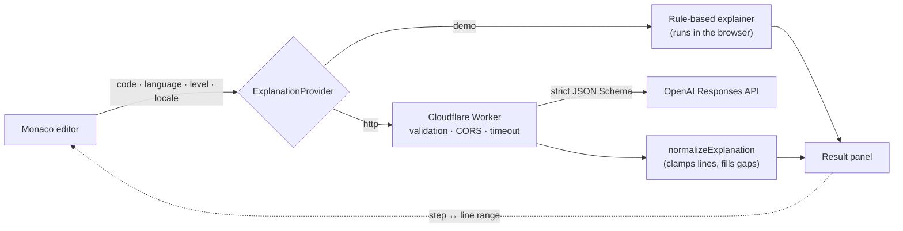

<div align="center">

# Code Translator

**Turn unfamiliar code into a step-by-step lesson.**

Paste Python, JavaScript, or TypeScript and get a plain-language walkthrough: purpose first, then the flow, each step linked to the lines it explains, key concepts, things to watch out for, and a quick quiz.

[**Live demo**](https://alkalimiu.github.io/code-translator/) · [中文说明](README.zh-CN.md) · [Report an issue](https://github.com/AlkaliMiu/code-translator/issues)

[](https://github.com/AlkaliMiu/code-translator/actions/workflows/ci.yml)
[](https://github.com/AlkaliMiu/code-translator/actions/workflows/deploy-pages.yml)
[](LICENSE)


</div>

## Why

People who are new to programming usually meet the syntax before they understand the intent. A chat assistant can answer, but the answer is a wall of text that lives apart from the code. Code Translator returns a structured lesson instead and keeps it next to the code: hover a step and its lines light up like a highlighter; click a line and the matching step comes into view.

## Features

- **A lesson, not a chat**: every explanation has the same shape: summary → flow → steps → concepts → things to notice → quiz.
- **Code and explanation stay linked**: hovering or selecting a step highlights its line range in the Monaco editor; clicking a line selects its step.
- **Three levels plus "Explain more simply"**: Beginner, Learner and Advanced change vocabulary and depth.
- **Seven languages**: English (default), 中文, Français, Deutsch, Español, 日本語 and Русский. Examples, demo explanations, error messages and AI output follow the chosen language, and the choice is remembered.
- **Works without an API key**: a rule-based demo mode runs entirely in the browser and is clearly labelled as such.
- **Optional AI backend**: a Cloudflare Worker calls the OpenAI Responses API with a strict JSON Schema.
- **Code is never executed**, and in demo mode it never leaves the browser.
- **Comfortable to use**: light and dark themes, <kbd>Ctrl</kbd>/<kbd>⌘</kbd> + <kbd>Enter</kbd> to translate, full keyboard support, reduced-motion support, and layouts from 320 px phones to wide desktops.

<p align="center">
  
  &nbsp;
  
</p>

## How it works



**Tech stack:** React 19, TypeScript, Vite, Monaco Editor, Vitest, ESLint, Cloudflare Workers, GitHub Actions and GitHub Pages.

## Design decisions

- **Structured output over free text.** A fixed schema mirrors how a teacher explains code (what it is for, how it runs, line by line) and gives the UI line ranges it can link to the editor.
- **Model output is untrusted.** The Worker asks for a strict JSON Schema and re-checks the result. The client then runs `normalizeExplanation`, which clamps line numbers to the real file, caps list lengths and fills missing fields in the reader's language.
- **Pasted code is untrusted too.** The prompt fences it inside `<UNTRUSTED_CODE>` and tells the model to ignore any instructions it contains. Nothing is run, and URLs in the code are never visited.
- **Swappable providers.** The demo and HTTP providers share one `ExplanationProvider` interface, so the whole UI works offline, in CI and on GitHub Pages without secrets.
- **Errors are codes, not sentences.** The Worker returns `{ code, error }`, and the client turns `code` into a message in the reader's language. The English `error` text is only for logs.
- **Translations are type-checked.** Every locale implements one `Messages` interface, so a missing key is a compile error. Tests also fail if an interface string was left in English. Plurals use `Intl.PluralRules` (Russian: 1 строка, 3 строки, 5 строк), and numbers use `Intl.NumberFormat` (12,000 · 12.000 · 12 000).
- **Typography follows the language.** `<html lang>` tracks the interface, so Japanese gets Japanese fonts instead of Chinese glyph forms, Japanese headings break at phrase boundaries (`word-break: auto-phrase`), and German, French, Spanish and Russian paragraphs hyphenate.
- **Accessible by default.** Levels and quiz answers are native radio inputs, focus is always visible, loading is announced with `aria-live`, and motion is reduced when the system asks for it.

## Languages

| Code | Language | Notes |
| --- | --- | --- |
| `en` | English | Default |
| `zh` | 简体中文 | |
| `fr` | Français | Non-breaking spaces before `: ; ! ?` |
| `de` | Deutsch | |
| `es` | Español | |
| `ja` | 日本語 | Japanese font stack and phrase-aware line breaks |
| `ru` | Русский | Three plural forms |

The interface starts in English. Picking another language in the header switches the whole app, including example code strings, and the choice is saved in `localStorage`.

**Adding a language**

1. Add its code to `AppLocale` in `src/types/explanation.ts`.
2. Copy `src/i18n/locales/en.ts`, translate it, and register it in `src/i18n/index.ts`.
3. Add the language name to `OUTPUT_LANGUAGES` in `worker/src/index.ts`.
4. Run `pnpm test`. The tests fail if a key is missing, empty or still in English.

## Getting started

You need Node.js 22+ and pnpm 11.

```bash
pnpm install
pnpm dev
```

Open the URL Vite prints. No API key is needed: the app starts in demo mode.

| Command | What it does |
| --- | --- |
| `pnpm dev` | Starts the Vite dev server |
| `pnpm test` | Runs the Vitest unit tests |
| `pnpm lint` | Runs ESLint |
| `pnpm build` | Type-checks and builds for production |
| `pnpm check` | Runs all of the above plus the Worker type check (this is what CI runs) |

## Configuration

Copy `.env.example` to `.env.local`:

```env
VITE_AI_PROVIDER=demo
VITE_AI_ENDPOINT=https://your-worker.example.workers.dev
VITE_AI_TIMEOUT_MS=25000
```

- `demo`: explanations come from local rules in the browser, and code is never uploaded.
- `http`: the app sends a structured request to `${VITE_AI_ENDPOINT}/explain`.
- Every `VITE_` variable ends up in the public bundle, so **never put an API key here**.

## Deployment

### GitHub Pages

1. Push the repository with `main` as the default branch.
2. In **Settings → Pages → Build and deployment**, set **Source** to **GitHub Actions**.
3. Push to `main`, or run **Deploy to GitHub Pages** from the Actions tab. The workflow installs dependencies, runs every check, and publishes `dist`.

Vite uses a relative base (`./`), so the build works under `username.github.io/repository/` and on a custom domain. There is no client-side routing, so refreshes never hit Pages' 404 fallback.

To use the AI backend on Pages, add these **variables** (not secrets, because they are public) under **Settings → Secrets and variables → Actions → Variables**: `VITE_AI_PROVIDER=http`, `VITE_AI_ENDPOINT=https://your-worker.workers.dev`, and optionally `VITE_AI_TIMEOUT_MS`.

### AI backend (Cloudflare Worker)

`worker/` is a standalone Worker. It:

- reads `OPENAI_API_KEY` from a server-side secret;
- validates the language, level, interface locale and a 12,000-character limit;
- only answers origins listed in `ALLOWED_ORIGINS`;
- times out after 28 seconds and always replies with JSON `{ code, error }` errors;
- fences the code as untrusted input and asks for strict Structured Outputs, then re-checks the result before returning it.

```bash
cd worker
pnpm install
pnpm exec wrangler login
pnpm exec wrangler secret put OPENAI_API_KEY
```

Edit `worker/wrangler.toml`:

```toml
[vars]
ALLOWED_ORIGINS = "http://localhost:5173,https://your-name.github.io"
OPENAI_MODEL = "gpt-4o-mini"
```

Then run `pnpm dev` to try it locally or `pnpm deploy` to publish. Point `VITE_AI_ENDPOINT` at the Worker URL, set `VITE_AI_PROVIDER=http`, and rebuild the frontend. For request fields and supported models, see the [OpenAI Structured Outputs guide](https://developers.openai.com/api/docs/guides/structured-outputs).

## Response shape

Both providers return the type defined in `src/types/explanation.ts`:

```ts
interface ExplanationResult {
  summary: string
  flow: string[]
  steps: Array<{
    id: string
    title: string
    explanation: string
    detail: string
    lineStart: number
    lineEnd: number
    concepts: string[]
  }>
  concepts: Array<{ name: string; explanation: string }>
  warnings: Array<{ title: string; detail: string; severity: 'note' | 'caution'; lineStart?: number; lineEnd?: number }>
  quiz: { question: string; options: string[]; answer: number; explanation: string }
  meta: { provider: 'demo' | 'ai'; generatedAt: string; disclaimer: string }
}
```

## Project structure

```text
src/
  components/        UI components (header, editor, result panel, quiz, …)
  config/            settings shared by every language (repository URL, limits)
  data/              built-in examples, localized per language
  i18n/              Messages type, one dictionary per language, and tests
  providers/         demo and HTTP providers
  types/             explanation data types
  utils/             language detection and response normalization
worker/              Cloudflare Worker AI backend
docs/screenshots/    images used in this README
.github/workflows/   CI for pull requests and the GitHub Pages deployment
```

## Security and privacy

- The app only reads code. It never executes what you paste.
- Demo mode keeps code in the browser; HTTP mode sends it to the Worker you configured, and the UI says so.
- The interface reminds people to remove passwords, keys and customer data before using AI mode.
- API keys live only in Worker secrets, never in `.env*`, frontend code, Actions variables or `wrangler.toml`.
- AI explanations can be wrong, and the UI never presents them as certain.
- For a public deployment, add rate limiting, abuse protection, log redaction and cost alerts in front of the Worker.

## Limitations and ideas

- The demo provider is a set of heuristics. It shows the experience, but it does not understand code the way a model does.
- Language detection is lightweight and can guess wrong on very short or mixed snippets; you can always switch manually.
- Explanations cover one file at a time, without repository context, dependencies or runtime state.
- Ideas for later: more programming languages, shareable links to an explanation, rate limiting in the Worker, and bundling Monaco instead of loading it from a CDN.

## License

[MIT](LICENSE) © 2026 Fangcan Chi
