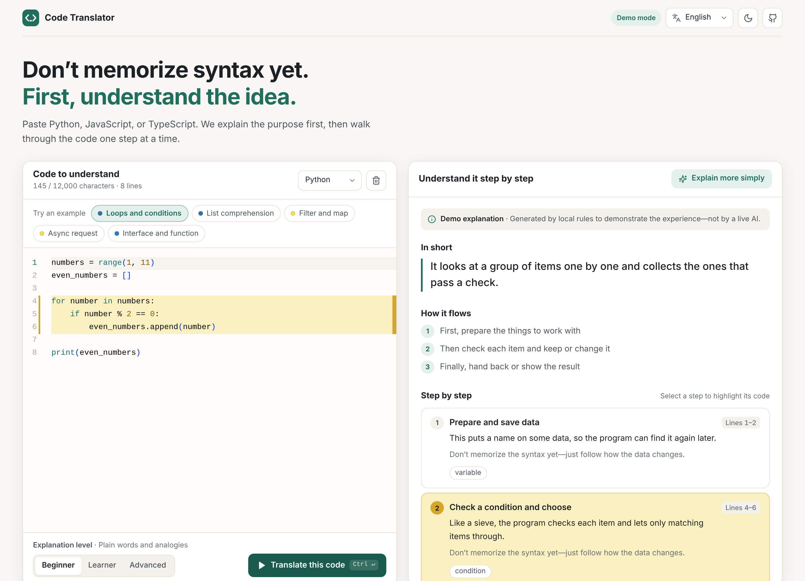
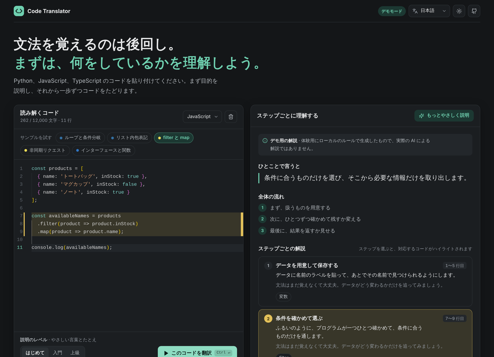
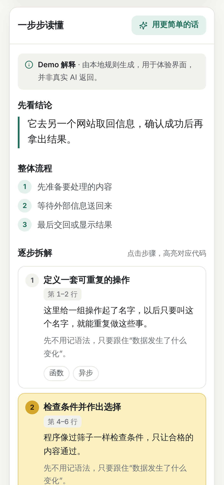
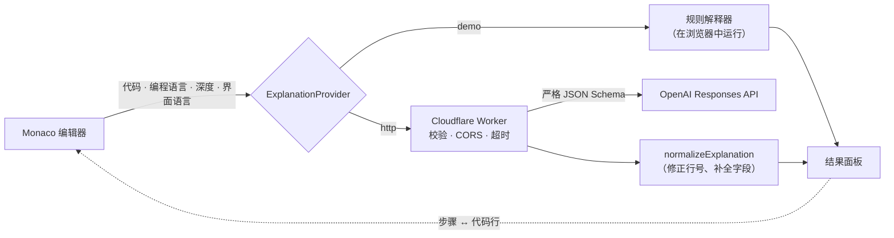

<div align="center">

# 代码翻译器 · Code Translator

**把陌生代码，变成一步步看懂的教材。**

粘贴 Python、JavaScript 或 TypeScript，得到一份用人话写的讲解：先讲用途，再讲流程；每个步骤都对应到具体代码行，最后还有关键概念、注意事项和小测验。

[**在线体验**](https://alkalimiu.github.io/code-translator/) · [English](README.md) · [反馈问题](https://github.com/AlkaliMiu/code-translator/issues)

[](https://github.com/AlkaliMiu/code-translator/actions/workflows/ci.yml)
[](https://github.com/AlkaliMiu/code-translator/actions/workflows/deploy-pages.yml)
[](LICENSE)



</div>

## 为什么做这个

刚开始学编程的人读别人的代码时，往往先被语法卡住，还没弄清代码想做什么。聊天式 AI 能回答，但回答是一大段和代码分离的文字。代码翻译器给出的是一份结构固定的教材，并且始终和代码并排：把鼠标放在某个步骤上，对应的代码行会像荧光笔一样亮起；点击某一行代码，对应的步骤会出现在视野中。

## 功能

- **教材，而不是聊天**：每次解释都是同样的结构，依次为一句话结论、整体流程、逐步拆解、涉及的概念、值得留意和快速检查。
- **代码与解释双向联动**：悬停或点选步骤会在 Monaco 编辑器中高亮对应行；点击代码行会定位到对应步骤。
- **三种深度 + “用更简单的话”**：零基础、入门、进阶，用词和深度各不相同。
- **七种界面语言**：English（默认）、中文、Français、Deutsch、Español、日本語、Русский。示例代码里的字符串、Demo 解释、错误提示和 AI 输出都会跟随所选语言，并会记住你的选择。
- **无需 API Key 即可完整体验**：Demo 模式完全在浏览器内用规则生成解释，界面会明确标注。
- **可选的 AI 后端**：Cloudflare Worker 调用 OpenAI Responses API，并使用严格的 JSON Schema。
- **从不执行代码**；Demo 模式下代码也不会离开浏览器。
- **用起来舒服**：浅色和深色主题，<kbd>Ctrl</kbd>/<kbd>⌘</kbd> + <kbd>Enter</kbd> 快捷翻译，完整的键盘操作，支持“减少动态效果”，从 320 px 手机到宽屏桌面都适配。

<p align="center">
  
  &nbsp;
  
</p>

## 工作原理



**技术栈**：React 19、TypeScript、Vite、Monaco Editor、Vitest、ESLint、Cloudflare Workers、GitHub Actions、GitHub Pages。

## 设计取舍

- **结构化输出，而非自由文本。** 固定的结构贴近老师讲代码的顺序（先讲用途，再讲怎么跑，最后逐行讲），也让界面拿到可以和编辑器联动的行号范围。
- **模型输出不可信。** Worker 要求模型遵循严格的 JSON Schema 并再次校验；前端再用 `normalizeExplanation` 把行号限制在真实范围内、限制列表长度，并用读者的语言补全缺失字段。
- **粘贴的代码同样不可信。** 提示词把代码包在 `<UNTRUSTED_CODE>` 中，并要求模型忽略其中的任何指令；代码不会被执行，其中的网址也不会被访问。
- **可替换的 provider。** Demo 与 HTTP provider 实现同一个 `ExplanationProvider` 接口，所以整个界面在离线、CI 和 GitHub Pages 上都无需密钥即可运行。
- **错误用代码表示，而不是句子。** Worker 返回 `{ code, error }`，前端根据 `code` 显示读者语言的提示；英文的 `error` 只用于日志。
- **翻译受类型检查保护。** 每种语言都实现同一个 `Messages` 接口，少一个键就无法编译；测试还会检查是否有界面文案仍是英文。复数形式用 `Intl.PluralRules`（俄语：1 строка、3 строки、5 строк），数字用 `Intl.NumberFormat`（12,000 · 12.000 · 12 000）。
- **排版跟随语言。** `<html lang>` 随界面切换，因此日文会使用日文字体，而不是中文字形；日文标题按词组断行（`word-break: auto-phrase`）；德、法、西、俄文段落会自动断字。
- **默认可访问。** 深度选择和测验选项使用原生单选框，焦点始终可见，加载状态通过 `aria-live` 播报，并尊重系统的“减少动态效果”设置。

## 语言

| 代码 | 语言 | 说明 |
| --- | --- | --- |
| `en` | English | 默认语言 |
| `zh` | 简体中文 | |
| `fr` | Français | `: ; ! ?` 前使用不换行空格 |
| `de` | Deutsch | |
| `es` | Español | |
| `ja` | 日本語 | 日文字体与按词组断行 |
| `ru` | Русский | 三种复数形式 |

界面默认是英文。在页眉选择其他语言后，整个应用（包括示例代码中的字符串）都会切换，选择会保存在 `localStorage` 中。

**添加一种语言**

1. 在 `src/types/explanation.ts` 的 `AppLocale` 中加入语言代码。
2. 复制 `src/i18n/locales/en.ts` 并翻译，然后在 `src/i18n/index.ts` 中注册。
3. 在 `worker/src/index.ts` 的 `OUTPUT_LANGUAGES` 中加入该语言的名称。
4. 运行 `pnpm test`。如果有缺失、为空或仍是英文的文案，测试会失败。

## 本地运行

需要 Node.js 22+ 与 pnpm 11。

```bash
pnpm install
pnpm dev
```

打开终端显示的本地地址即可。默认是 Demo 模式，不需要任何 API Key。

| 命令 | 作用 |
| --- | --- |
| `pnpm dev` | 启动 Vite 开发服务器 |
| `pnpm test` | 运行 Vitest 单元测试 |
| `pnpm lint` | 运行 ESLint |
| `pnpm build` | 类型检查并生成生产构建 |
| `pnpm check` | 依次运行以上全部检查和 Worker 类型检查（CI 运行的就是它） |

## 前端配置

复制 `.env.example` 为 `.env.local`：

```env
VITE_AI_PROVIDER=demo
VITE_AI_ENDPOINT=https://your-worker.example.workers.dev
VITE_AI_TIMEOUT_MS=25000
```

- `demo`：只在浏览器中运行本地解释规则，不上传代码。
- `http`：向 `${VITE_AI_ENDPOINT}/explain` 发送结构化请求。
- 所有 `VITE_` 变量都会进入前端构建产物，所以这里只能放公开配置，**绝不能放 API Key**。

## 部署

### GitHub Pages

1. 以 `main` 作为默认分支推送仓库。
2. 在 **Settings → Pages → Build and deployment** 中，将 **Source** 设为 **GitHub Actions**。
3. 推送 `main`，或在 Actions 页面手动运行 **Deploy to GitHub Pages**。工作流会安装依赖、运行全部检查，并发布 `dist`。

Vite 使用相对资源基址 `./`，因此同时适配 `username.github.io/repository/` 子路径和自定义域名。项目没有客户端路由，刷新不会遇到 Pages 的 404 回退问题。

若要在 Pages 上使用 AI 后端，请在 **Settings → Secrets and variables → Actions → Variables** 中添加以下**变量**（它们是公开的，所以不用 Secret）：`VITE_AI_PROVIDER=http`、`VITE_AI_ENDPOINT=https://你的-worker.workers.dev`，以及可选的 `VITE_AI_TIMEOUT_MS`。

### AI 后端（Cloudflare Worker）

`worker/` 是一个可独立部署的 Worker，它会：

- 从服务端 Secret 读取 `OPENAI_API_KEY`；
- 校验编程语言、解释深度、界面语言和 12,000 字符上限；
- 只响应 `ALLOWED_ORIGINS` 中列出的来源；
- 28 秒超时，所有错误都以 JSON `{ code, error }` 返回；
- 把代码作为不可信输入包裹起来，要求模型使用严格的 Structured Outputs，并在返回前再次校验结果。

```bash
cd worker
pnpm install
pnpm exec wrangler login
pnpm exec wrangler secret put OPENAI_API_KEY
```

编辑 `worker/wrangler.toml`：

```toml
[vars]
ALLOWED_ORIGINS = "http://localhost:5173,https://你的用户名.github.io"
OPENAI_MODEL = "gpt-4o-mini"
```

然后用 `pnpm dev` 本地调试，或用 `pnpm deploy` 发布。把 Worker 地址填入 `VITE_AI_ENDPOINT`，设置 `VITE_AI_PROVIDER=http`，再重新构建前端。请求字段与支持的模型请参考 [OpenAI Structured Outputs 官方文档](https://developers.openai.com/api/docs/guides/structured-outputs)。

## 返回数据

两种 provider 都返回 `src/types/explanation.ts` 中定义的类型：

```ts
interface ExplanationResult {
  summary: string
  flow: string[]
  steps: Array<{
    id: string
    title: string
    explanation: string
    detail: string
    lineStart: number
    lineEnd: number
    concepts: string[]
  }>
  concepts: Array<{ name: string; explanation: string }>
  warnings: Array<{ title: string; detail: string; severity: 'note' | 'caution'; lineStart?: number; lineEnd?: number }>
  quiz: { question: string; options: string[]; answer: number; explanation: string }
  meta: { provider: 'demo' | 'ai'; generatedAt: string; disclaimer: string }
}
```

## 项目结构

```text
src/
  components/        界面组件（页眉、编辑器、结果面板、测验等）
  config/            所有语言共用的设置（仓库地址、长度上限）
  data/              内置示例，按语言本地化
  i18n/              Messages 类型、每种语言一个词典，以及测试
  providers/         Demo 与 HTTP provider
  types/             解释结果的数据类型
  utils/             语言识别与响应归一化
worker/              Cloudflare Worker AI 后端
docs/screenshots/    README 中使用的截图
.github/workflows/   Pull Request 的 CI 与 GitHub Pages 部署
```

## 安全与隐私

- 本项目只读代码，绝不执行用户粘贴的代码。
- Demo 模式下代码留在浏览器中；HTTP 模式会把代码发送到你配置的 Worker，界面会明确说明。
- 界面会提醒用户在使用 AI 模式前删除密码、密钥、客户数据等敏感信息。
- API Key 只保存在 Worker Secret 中，不要放在 `.env*`、前端代码、Actions 变量或 `wrangler.toml` 里。
- AI 解释可能出错，界面不会把它当作确定的结论。
- 若要公开部署，建议在 Worker 前增加速率限制、滥用防护、日志脱敏与成本告警。

## 当前限制与后续想法

- Demo provider 是一组启发式规则，用来展示体验，并不像模型那样真正理解代码。
- 语言自动识别是轻量规则，遇到很短或混合的片段可能判断错误，可以手动切换。
- 目前一次只解释一个文件，不了解整个仓库、依赖关系或运行时状态。
- 后续想法：支持更多编程语言、可分享的解释链接、Worker 内置速率限制、改为打包 Monaco 而不是从 CDN 加载。

## 许可证

[MIT](LICENSE) © 2026 Fangcan Chi
